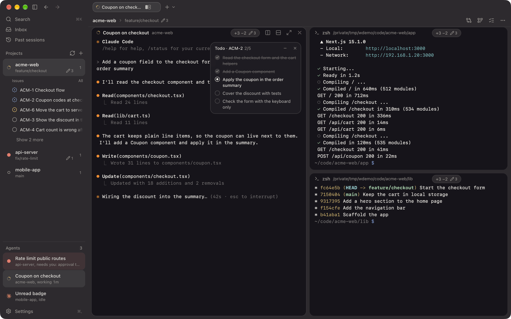
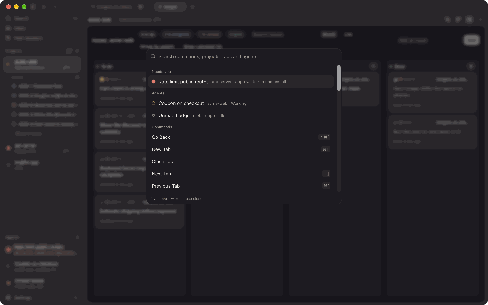
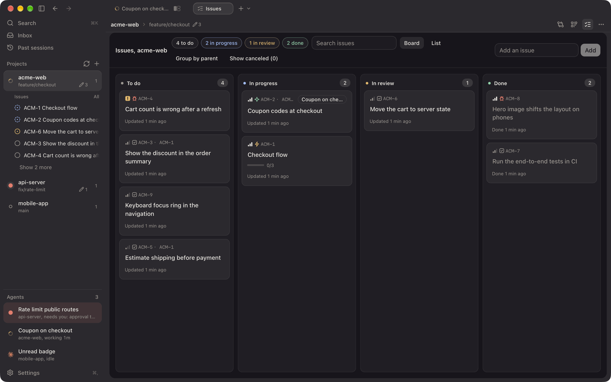
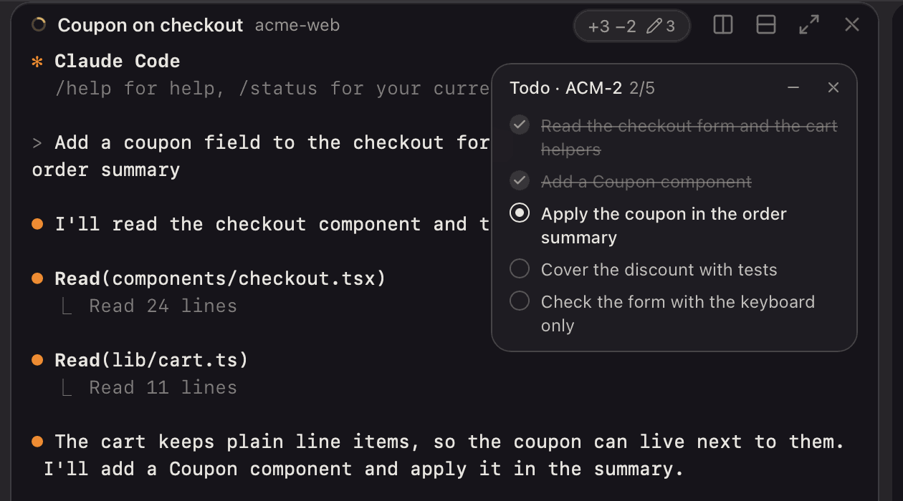

# Wings

A terminal workspace for coding agents such as Claude Code and opencode. Your projects sit in a sidebar next to the agents running in them, and every project has tabs and split panes of real terminals.



Wings is a Tauri 2 and React 19 app for macOS. It is MIT licensed.

## Features

### Know what every agent is doing

The sidebar lists your projects and the agents in each one, and shows whether an agent is working, waiting or needs you. Press ⌘J to jump to the agent that needs you. A global shortcut, ⌃⌥J by default, brings Wings forward and goes there from any app. You can change it in Settings, Keyboard.

A notification list keeps track of the times an agent needed you or finished.

### Tabs and split panes

Each project has tabs, and each tab can split into panes. Rename, reorder and move them by dragging or from the right-click menus. Tabs, splits and the font size come back on the next launch, and panes that were running Claude Code resume their session.

### Command palette

⌘K opens a palette for commands, projects, tabs, agents and sessions. It lists every shortcut. The Tab, Pane and View menus show them too.



### Issues, and the agent's todo

The Issues plugin keeps a local tracker for each project, with types, specs, priorities, links to commits and PRs, and an activity log. See the issues on a board, as rows by epic, or as a list. Claude Code reads and writes them through tools, and a session start line tells it to track its work there. A setting keeps issue keys out of its commits and PRs.



The agent also keeps its own step list with `tasks__todo`. It shows as a card floating over its pane, and on a Todo tab with the history kept.



### Review and history

- Diff review: comment on lines of a diff and send the comments to the agent in that repo.
- Past sessions: browse history and resume a session.
- Worktrees: start an agent in a new git worktree from a project's right-click menu, and list or clean up worktrees with the Worktrees plugin.
- Project page: each project has a page of facts, sections and blocks that plugins add to. Agents can read and write it too.

### Plugins

A plugin adds badges, sidebars, tabs, blocks and actions to Wings, and can answer Claude Code hooks. Plugins run in a sandbox and can only do what you approved. This repo has plugins for:

- Changes: changed files per pane, the repo's history and a commit graph.
- Dev servers: a badge with the port while a program in a pane listens on one.
- HUD: Claude Code usage.
- Issues: the tracker above.
- PR tracker: the pull request for each pane's branch, with its checks.
- Session detail, Work item and Worktrees.

## Install

Download the latest build from the [releases page](https://github.com/josippapez/Wings/releases) (macOS). Wings checks for new releases on start and every six hours, and offers "Install and restart" in the app.

The app is signed with a self-signed certificate and is not notarized, so the first time you open it macOS shows a Gatekeeper warning. Right-click Wings in Applications and choose Open. See [docs/releasing.md](docs/releasing.md).

## Build from source

You need Rust (`rustup`), Node 24 and pnpm.

```sh
cd apps/desktop
pnpm install
pnpm tauri dev      # run the app
pnpm build          # type-check and build the UI
pnpm test           # UI tests
cargo test          # Rust tests, run in src-tauri/
```

`pnpm build:mac` builds the macOS app. Signing and releasing are in [docs/signing.md](docs/signing.md) and [docs/releasing.md](docs/releasing.md). More about the desktop app is in [apps/desktop/README.md](apps/desktop/README.md).

## Plugins

A plugin is a folder with a `wings-plugin.json` and some TypeScript, run in a sandbox and limited to the permissions it declares. See [plugins/README.md](plugins/README.md) for installing and the plugins in this repo (Changes, Dev servers, HUD, Issues, PR tracker, Session detail, Work item, Worktrees). To write one, use [`wings-plugin-sdk`](https://www.npmjs.com/package/wings-plugin-sdk) and [`wings-plugin-ui`](https://www.npmjs.com/package/wings-plugin-ui), whose sources are in `packages/`.

## License

MIT. See [LICENSE](LICENSE).
